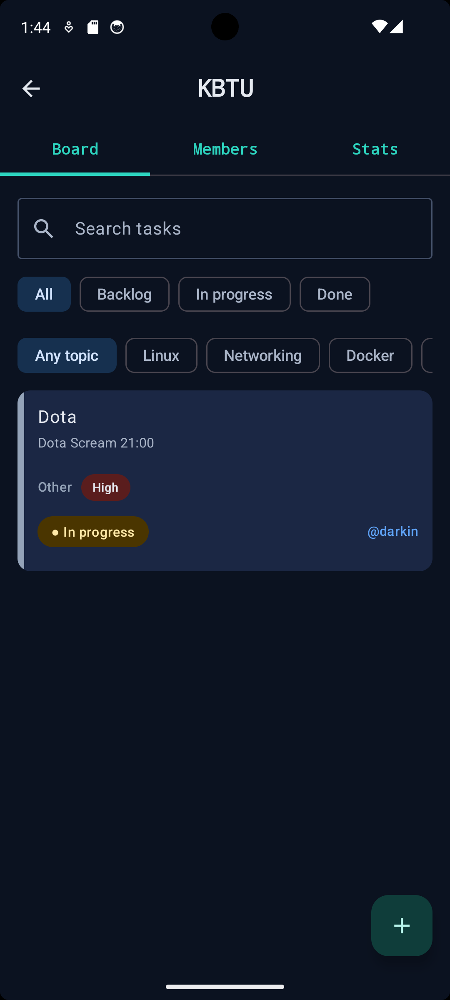
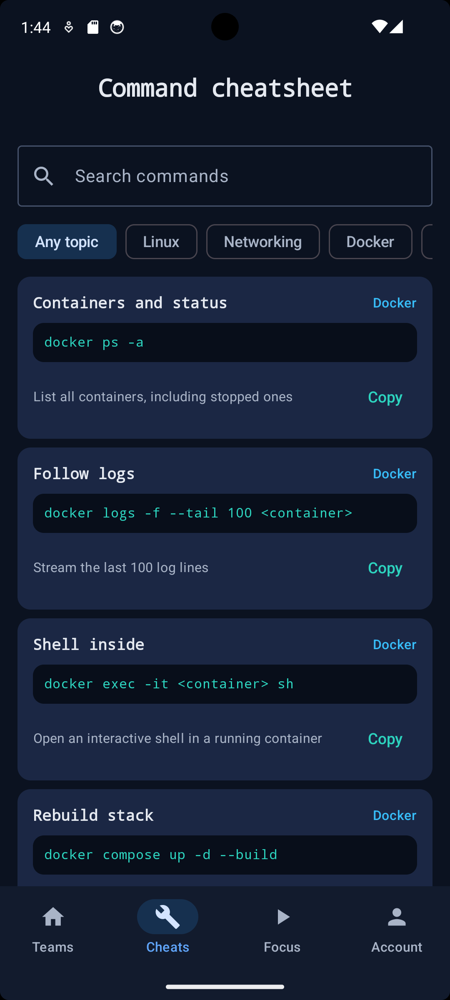
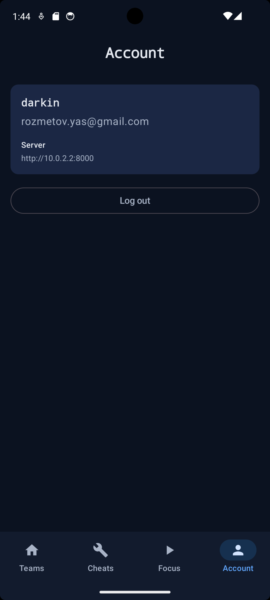

# DevOps Study Planner — Android (connected to the API)

Kotlin + Jetpack Compose + Material 3 client for the Study Planner backend (FastAPI + PostgreSQL in Docker).
Team boards, members, statistics and a command cheatsheet; the study timer works offline.

## Features
- **Register / log in** against the backend (JWT stored in SharedPreferences, automatic return to the login screen when the token expires). The server address can be changed on the login screen.
- **Teams**: list, create; owner renames, invites by e-mail, removes members, deletes the team; members can leave.
- **Board**: tasks of a team with search, filters by stage and topic (applied by the API); tap the status pill to move a task *Backlog → In progress → Done* (optimistic update with rollback on error); create / edit / delete tasks with topic, priority, stage, due date and assignee.
- **Stats**: overall progress, pipeline counters, certification goals (AWS SAA, CKA, Terraform Associate), progress by member and topic.
- **Cheats**: searchable DevOps commands with one-tap copy (offline).
- **Focus**: Pomodoro timer for a chosen topic; the countdown is a coroutine in a ViewModel and survives rotation (offline).

## Architecture
```
UI (Compose, stateless screens)  ui/*.kt
   ▲ state / events
ViewModels (StateFlow)           vm/AuthViewModel, TeamsViewModel, TeamViewModel, TaskEditViewModel, FocusViewModel
   ▲
Repository                       data/Repository.kt  (AppResult, error parsing)
   ▲
Retrofit + OkHttp + Gson         data/ApiService.kt, ApiClient.kt (Bearer interceptor, 401 handling)
   ▲
SessionStore (token, server URL) data/SessionStore.kt
```
Navigation Compose: `auth`, `teams`, `team/{teamId}`, `task/{teamId}/{taskId}`, `cheats`, `focus`, `account`.

## Run
1. Start the backend (see the backend README): `docker compose up --build`, check http://localhost:8000/health.
2. Android Studio → Run on an emulator (API 26+). Default server address: `http://10.0.2.2:8000` (the PC as seen from the emulator).
3. Register an account and create a team.

Real phone: same Wi-Fi as the PC, enter `http://<PC IP>:8000` under *Server settings* on the login screen (allow port 8000 in Windows Firewall).

## Tests
`./gradlew test` — enum/API mapping, error parsing, overdue logic, URL normalisation, focus timer state.

## Screenshots
| Login | Teams | Board | Task | Stats | Focus |
|---|---|---|---|---|---|
|  |  |  |  |  |  |
